# Watches

**A private catalogue for your watch collection.** Every watch, with its photos, full specifications, service history, box & papers and documents, kept on your own phone or Mac. No account, no cloud, no ads.

  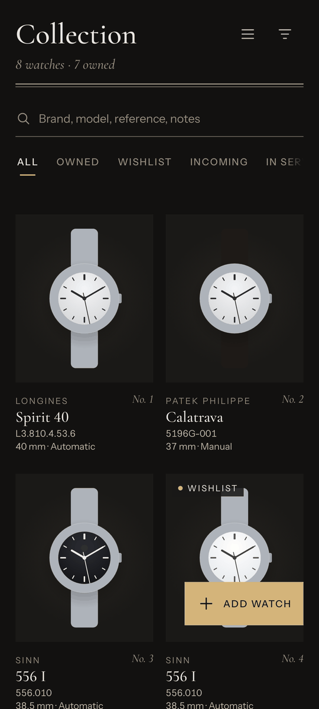
  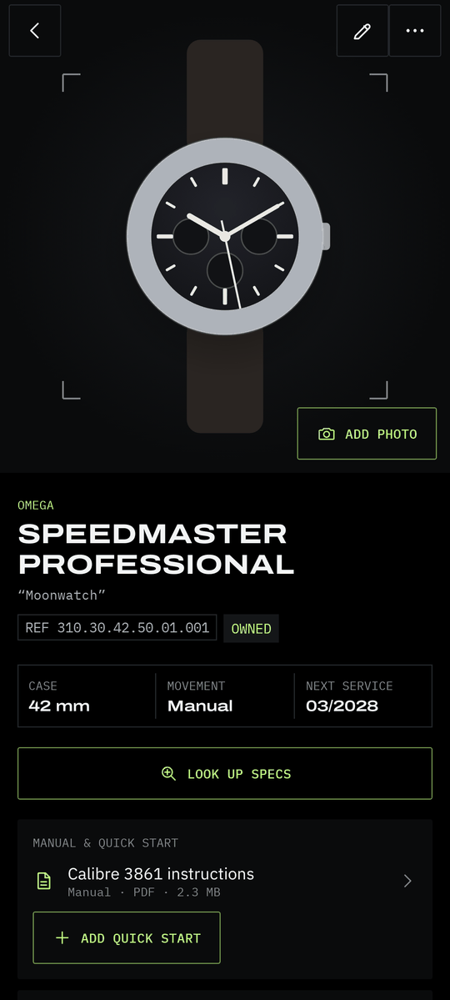
  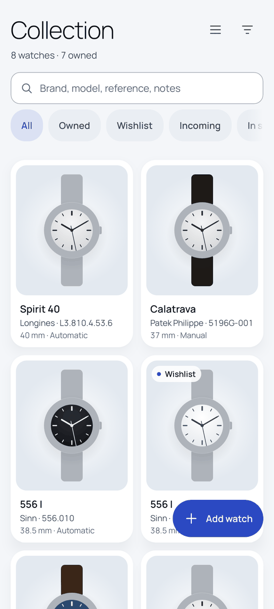

Screenshots show sample watches. A watch without a photo yet is drawn by the app.

For <b>Android</b> and <b>iPhone</b>, with a preview for <b>Mac</b>. 
<a href="#get-the-app">Get the app</a> · <a href="#what-it-does">What it does</a> · <a href="#private-by-design">Privacy</a> · <a href="#backups-and-moving-between-devices">Backups</a> · <a href="#questions">Questions</a>

## What it does

### Your collection, at a glance

Browse your watches as a grid of photos or a compact list. Search as you type, sort by brand, date acquired, case size or recently added, and filter by brand, movement, complications or case size. Tabs keep owned watches, your wishlist, incoming watches, watches away for service, sold watches and the archive apart.

It's built to stay quick with 500 watches or more, photos and all.

### Every detail of every watch

Each watch has a page of its own: its photos, then a spec sheet in the groups a collector expects: identity, case, dial, movement, strap & bracelet, ownership, and service & warranty. Sizes are in millimetres, water resistance in metres with ATM or bar beside it, beat rate in vibrations per hour with hertz, and power reserve in hours (and days, from three days up). Long-press any value to copy it. The serial number stays hidden until you tap it.

Add a watch by hand with a form that knows watches: brands already in your collection are suggested as you type, common answers (sapphire, Super-LumiNova, folding clasp…) are one tap away, number fields understand units, and complications are a tick-list. Or start from Lookup, below.

  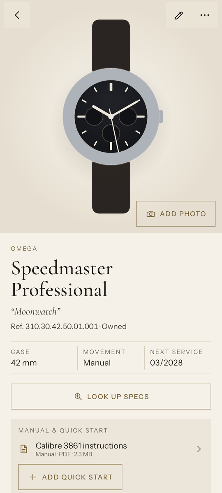
  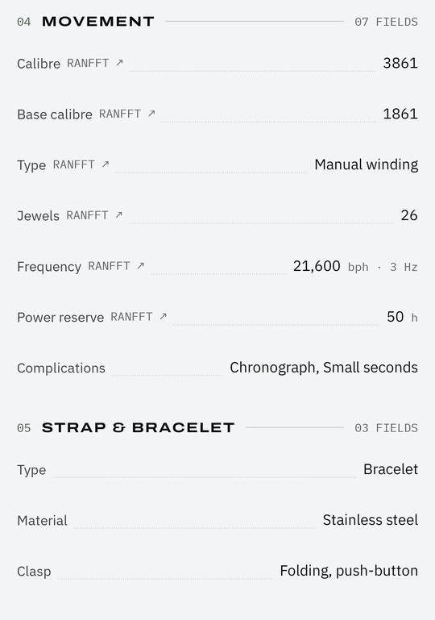

### Photos

Take photos with the camera or pick them from your library. Reorder them, choose the cover, and crop. **The location is removed from every photo** you add, and the picture itself is kept as it was. iPhone photos (HEIC) are fine.

### Look up specs

Search by name, reference or calibre, and Watches looks the watch up in public references:
- **Wikidata and Wikipedia**, for the brand, the model's history and its introduction;
- **Ranfft DB**, for calibres, with its owner's permission;
- **Grail Watch Reference**, for movements: jewels, beat rate, power reserve and more.

You review every value before it's saved, and tick the ones you want. **Anything you typed yourself is never replaced unless you tick it.** Each looked-up value remembers where and when it came from. Freely licensed pictures from Wikimedia Commons can be saved to a watch, with their credit.

  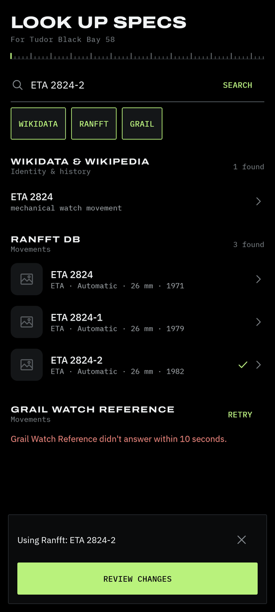
  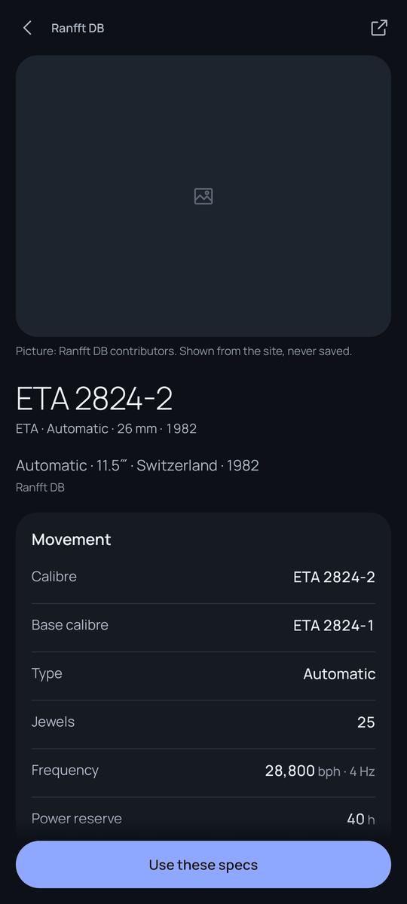
  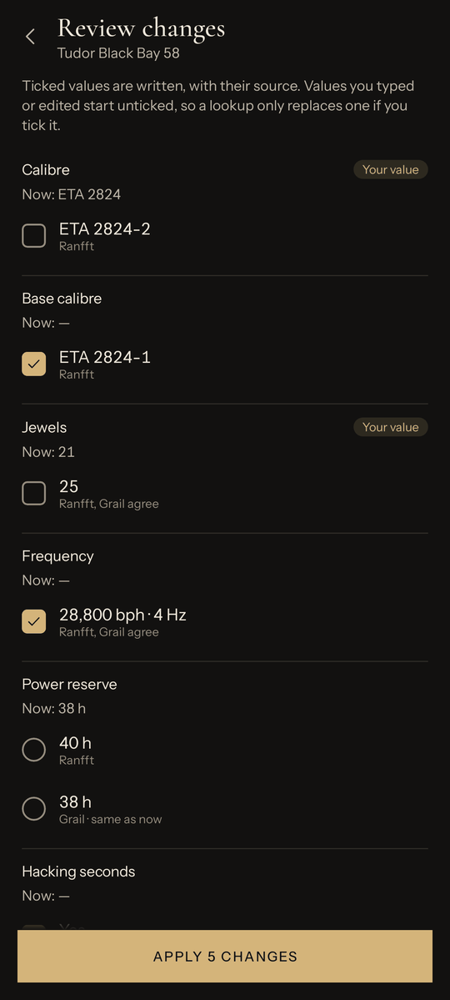

### Service, box & papers and warranty

- **Service history**, with who did it, what they did, the cost and the invoice.
- **When the next service is due**, worked out from the service interval and the last full service. The Service tab lists every watch that's overdue or due soon, and warranties that are ending.
- **Reminders**, if you want them: a notification at 9 am on the day a watch is due. Off unless you switch it on for that watch.
- **Box & papers**: a checklist of inner and outer box, warranty card, manual, hang tags, extra links and receipt. A watch with everything gets a **Full set** badge.
- **Warranty**: when it started and how long it lasts.

  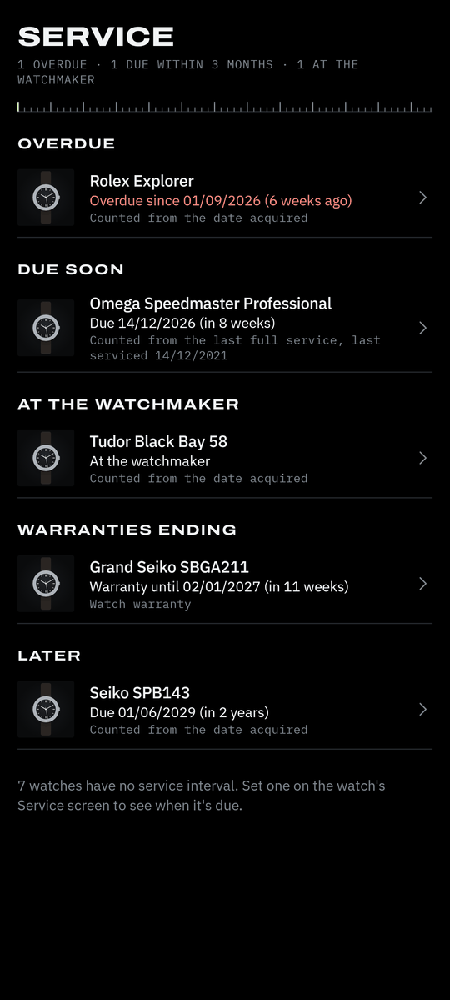
  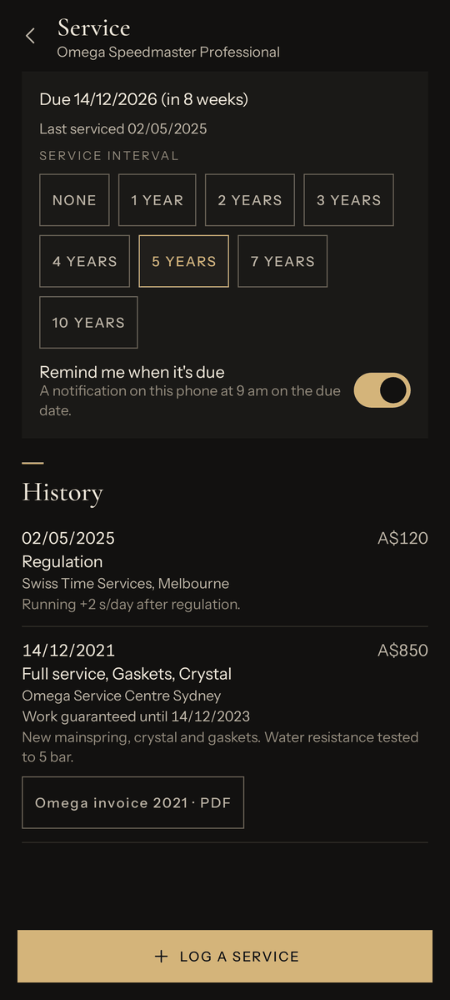
  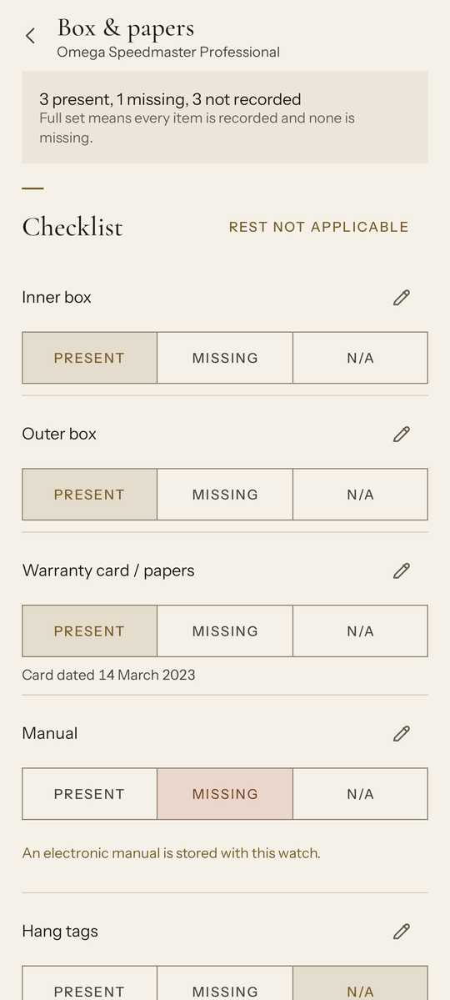

### Documents

Keep a watch's manual, quick start guide, receipts, invoices, warranty and certificates with it, as PDFs or pictures. Read them in the app and share them. Manuals and quick start guides come first, and can be reused for another watch of the same model.

  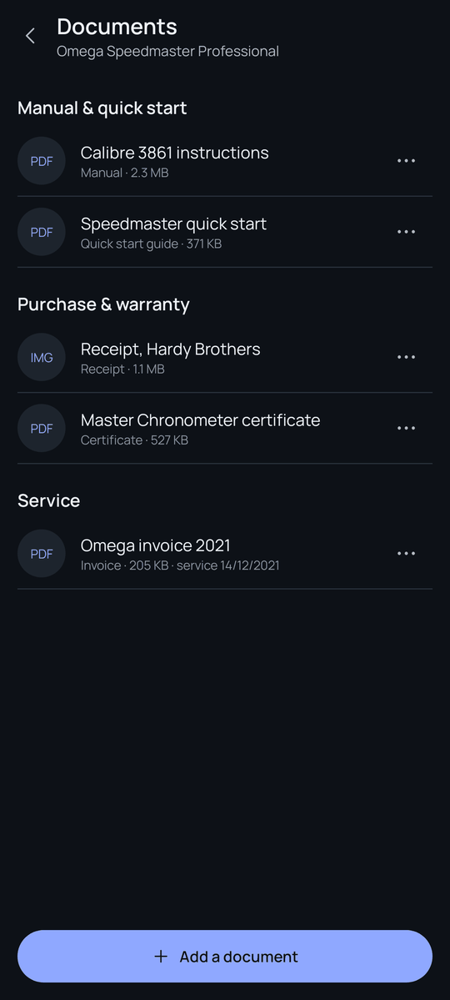

### Three designs

Choose the look that suits you, in Settings › Appearance. Each has light and dark modes and seven accent colours.

- **Atelier**, the catalogue: serif titles on warm graphite or ivory, quiet hairlines, like a fine-watch auction catalogue.
- **Instrument**, the data sheet: expanded capitals, mono figures and dotted leaders, like a tool watch's spec sheet. True black at night.
- **Gallery**, the white room: light type, soft cards and plenty of air, like a calm Scandinavian gallery.

  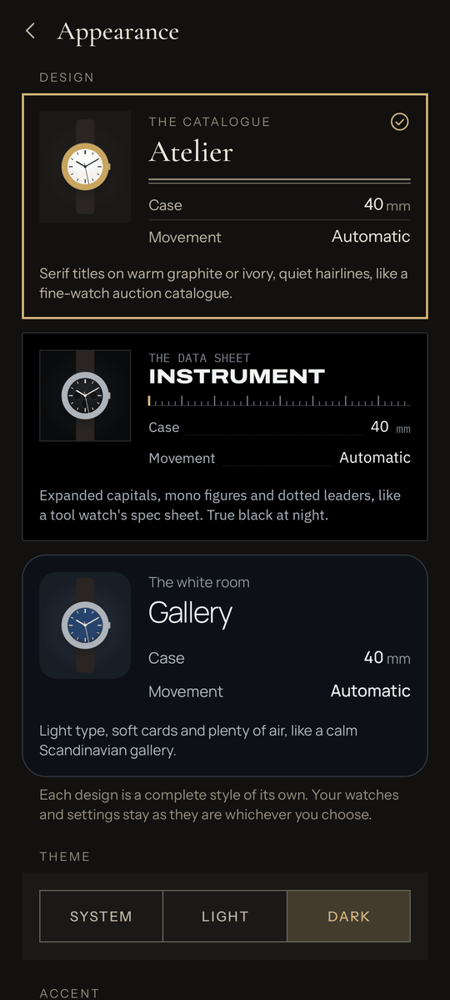
  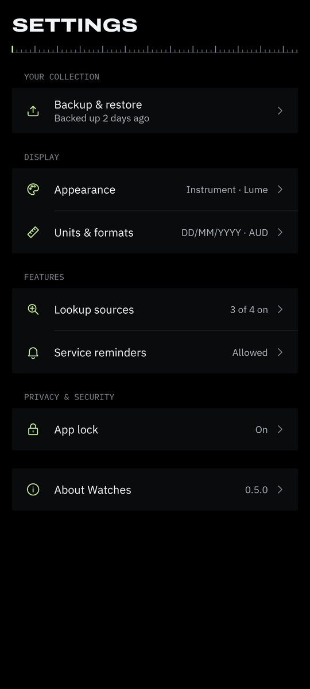

### Backup, restore and export

Back up your whole collection, photos and documents included, to a single file saved wherever your device's file picker reaches: a folder, a USB stick, or a cloud drive such as Google Drive or iCloud Drive. Restore it on the same device or another one, by replacing what's there or merging the two. Export a spreadsheet (CSV) of every watch and every field.

  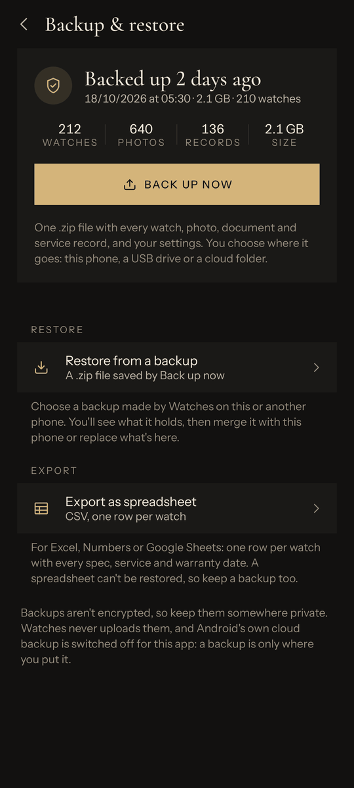
  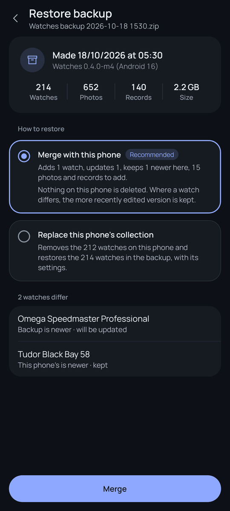

### App lock

Lock Watches with your fingerprint, face or the phone's PIN, at launch and after a time away that you choose. Off unless you turn it on.

## Private by design

- **Everything stays on your device.** No accounts, servers, analytics, ads or crash reporting.
- **Online only when you search.** Lookup is the only feature that uses the internet, and only when you press Search, open a result or save a picture. Settings › Lookup sources › Request log lists every request.
- **Polite to the sites it asks.** Lookups say who they are, wait at least a second between requests to a site, follow each site's rules for automated access, and never get around a block.
- **Not in cloud backups.** Your collection is left out of Android's and iCloud's own backups, so the only copies that leave your device are the backup files you save.
- **Few permissions.** On Android: internet (for Lookup), notifications (asked for only when you switch on a reminder) and biometrics (for the app lock). No location, contacts, storage or camera permission: photos are taken with the camera app, and backups are saved through the system's file picker. iPhone asks for the camera, notifications and Face ID only when you first use each.

  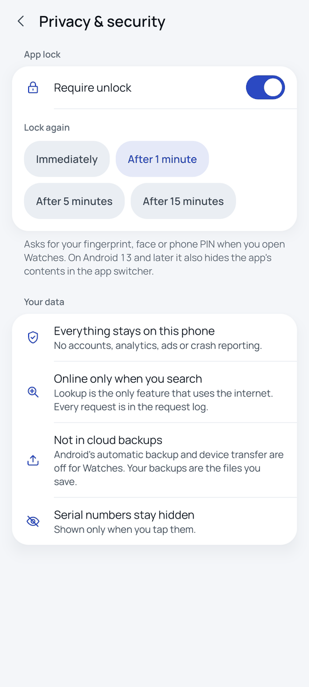
  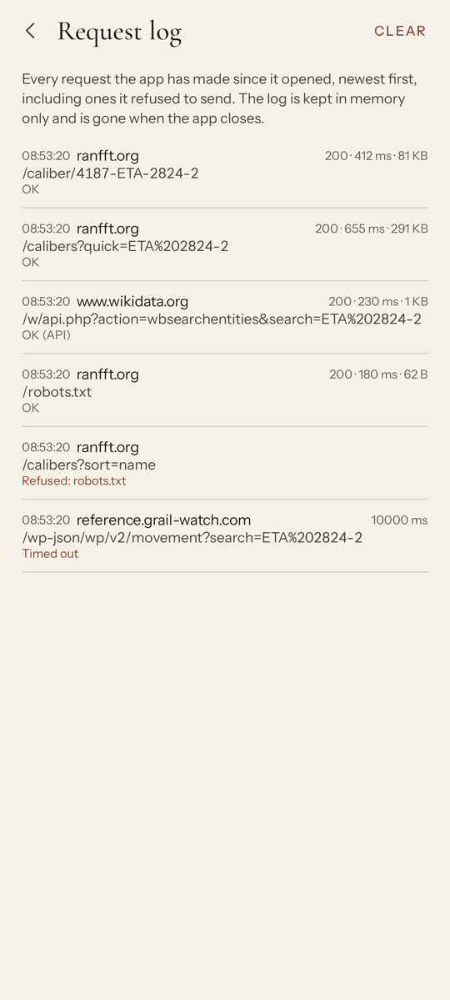

## Get the app

| | Android | iPhone | Mac |
| --- | --- | --- | --- |
| **Status** | Complete | Works; iPhone polish to come | Preview |
| **Needs** | Android 11 or newer | iOS 17 or newer, and TestFlight | Apple silicon, macOS 13 or newer |
| **From** | The APK on the [Releases](https://github.com/tunlezah/Watches/releases) page | TestFlight | The disk image on the [Releases](https://github.com/tunlezah/Watches/releases) page |

If the Releases page has no version yet (none has been published so far), the latest Android and Mac builds are on the repository's [Actions](https://github.com/tunlezah/Watches/actions) page: open the latest green run of the **Android** workflow (for the APK) or the **macOS** workflow (for the Mac), and download from its **Artifacts**. Builds are kept there for 14 days.

### Android

1. On the phone, open the [Releases](https://github.com/tunlezah/Watches/releases) page and download the latest `Watches-….apk`.
2. Open it. Android asks once to allow installs from that app (Files, Chrome or similar). Allow it.
3. Install.

If Android says the app wasn't installed because it conflicts with one already there, the new build was signed with a different key. See [Updating](#updating).

### iPhone

The iPhone app isn't on the App Store. It's installed through Apple's TestFlight, from an Apple Developer account that builds and uploads it ([BUILD.md](docs/BUILD.md#signing-and-testflight) has the one-time setup). Once a build is uploaded:

1. In App Store Connect, add yourself to an internal group under TestFlight › Internal Testing.
2. Install the TestFlight app on the iPhone, and install Watches from it.

Later builds install over it and keep your data. Each TestFlight build stops opening 90 days after it was uploaded, so a new one is needed at least that often. Your data stays on the phone in the meantime.

Everything works on iPhone, with a few rough edges still to smooth ([the plan](docs/IOS_PLAN.md) has them all):
- **Stay in the app while a backup or restore runs.** iOS pauses an app soon after you leave it, which stops a long backup.
- **The app switcher shows the app's contents**, even with the app lock on.
- **Some wording is Android's**, such as "fingerprint or phone PIN".

### Mac

1. Download `Watches-<version>-<build>-not-notarised.dmg`.
2. Open it and drag Watches to Applications.
3. The build isn't notarised by Apple yet, so the first time, macOS refuses to open it. Go to System Settings › Privacy & Security, find the message about Watches, and choose **Open Anyway**. That's needed once for each new build.

  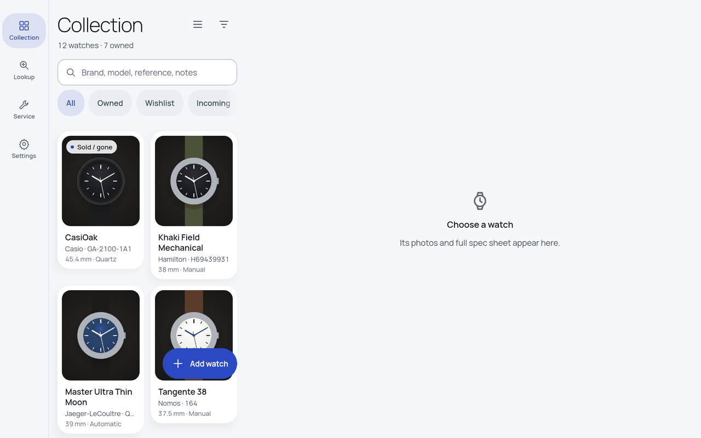

The Mac app is a preview. It has the collection, search, Lookup, service history, box & papers, documents, photos from files, backups and the three designs. For now it leaves out, and says so on screen:
- **taking a photo with the camera**: add photos from files instead;
- **reminders and the app lock**;
- **reading PDFs inside the app**: they open in Preview;
- **menus, shortcuts and Mac wording**: some screens still say "this phone".

Your collection is kept in `~/Library/Application Support/Watches/`. Dragging the app to the Bin leaves it there; delete that folder to remove it too. Only one copy of the app runs at a time.

## Backups and moving between devices

**Back up regularly.** Settings › Backup & restore › Back up now saves one `.zip` file with everything in it. Settings shows when you last backed up.

**To restore**, open Settings › Backup & restore, choose the file, and pick one of:
- **Replace**: the backup becomes your collection, and your settings come with it. Use this to move to a new device, or to go back to an earlier backup.
- **Merge**: the backup is added to what's there. Each watch in both is matched up, and the most recently edited version wins. Afterwards you get a list of every watch that differed.

Merge never deletes. A watch you deleted on one device comes back if you merge in a backup that still has it. To carry a deletion across, use Replace.

**Moving between Android, iPhone and Mac** works the same way: back up on one, and restore on the other. The simplest habit with more than one device is to edit on one, then back up there and restore everywhere else.

The app lock and the last-backup date belong to each device, and don't travel in a backup.

### Updating

- **iPhone:** TestFlight installs new builds over the old one.
- **Mac:** drag a newer Watches over the old one in Applications. Your collection stays. A build won't open a collection made by a newer build: it says so and changes nothing.
- **Android:** builds signed with the same key install over the top and keep your data. A build signed with a different key won't install over the app. Then: back up (Settings › Backup & restore), uninstall Watches, install the new APK, and restore your backup with Replace. The [release notes](https://github.com/tunlezah/Watches/releases) say when that's needed. To make every build install over the top, set up a signing key of your own: see [BUILD.md](docs/BUILD.md#optional-your-own-key-so-updates-install-over-the-top).

## Questions

**Does it need the internet?**
No. Everything works offline except Lookup. Without a connection, Lookup says so and sends nothing.

**Where are my photos and documents?**
Inside the app's own storage on the device, not in your photo library. A backup file carries all of them.

**Can I try it with sample watches?**
Yes. Settings › About Watches › Diagnostics adds 500 realistic sample watches, each with a generated photo, and removes them again afterwards. It also shows how fast the app opens, searches and opens a watch on your device.

**I'm moving from another app, or I keep a spreadsheet. Can I bring my collection?**
The app has no spreadsheet import. Instead, a list of watches can be turned into a Watches backup file, which you then restore. [BACKUP_IMPORT_SPEC.md](docs/BACKUP_IMPORT_SPEC.md) explains exactly how, step by step, for a developer or an AI assistant to follow.

**Is there a Windows version?**
Not yet. There's a [plan](docs/WINDOWS_PLAN.md) for one.

## More

| | |
| --- | --- |
| [CHANGELOG.md](CHANGELOG.md) | What changed in each version |
| [docs/BUILD.md](docs/BUILD.md) | Building from source, tests, signing, releasing and CI |
| [docs/ARCHITECTURE.md](docs/ARCHITECTURE.md) | How the app works inside: modules, Lookup, photos, backups, the app lock |
| [docs/DESIGN.md](docs/DESIGN.md) | The three designs in detail |
| [docs/SOURCES.md](docs/SOURCES.md) | Lookup's sources, their terms and what each covers |
| [docs/ARCHIVE_FORMAT.md](docs/ARCHIVE_FORMAT.md) | The backup file's format |
| [docs/PLAN.md](docs/PLAN.md), [IOS_PLAN.md](docs/IOS_PLAN.md), [MACOS_PLAN.md](docs/MACOS_PLAN.md), [WINDOWS_PLAN.md](docs/WINDOWS_PLAN.md) | Plans and decisions, for each platform |
